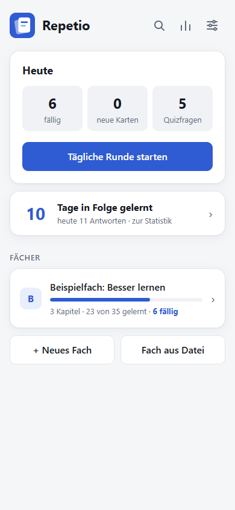
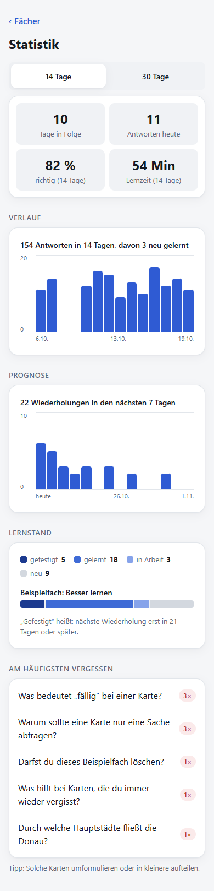
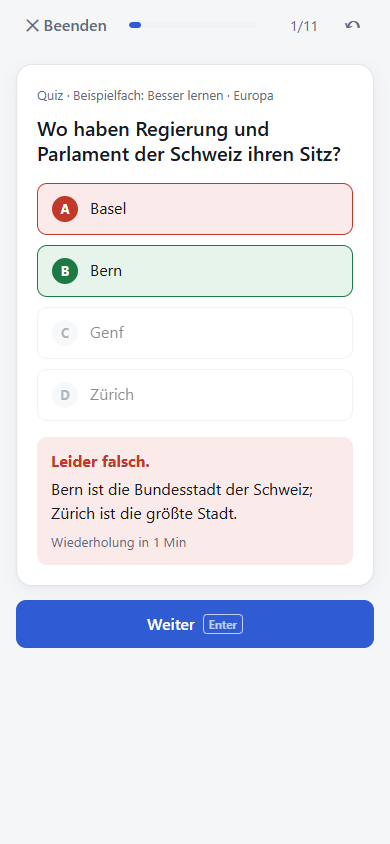
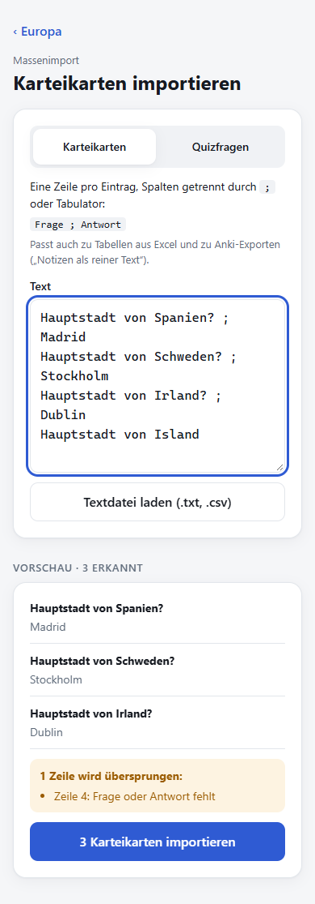
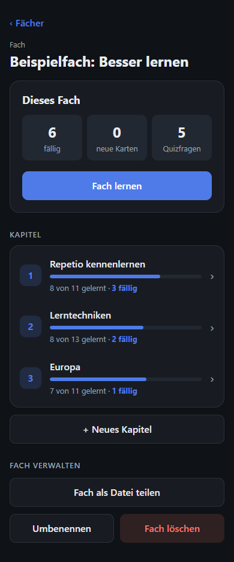

# Repetio

[](https://github.com/okankpl/Repetio/actions/workflows/deploy.yml)

**Karteikarten und Quizfragen mit Wiederholungsplan – für Smartphone und PC, auch offline.**

Repetio (lateinisch für „Wiederholung“) plant Wiederholungen nach dem Prinzip der verteilten Wiederholung (Spaced Repetition): Was sicher sitzt, kommt in immer größeren Abständen wieder, was falsch beantwortet wurde, noch in derselben Runde. Inhalte sind wie ein Register aufgebaut – **Fächer → Kapitel → Karteikarten und Quizfragen** – und lassen sich vollständig in der App anlegen, bearbeiten und importieren.

| Register                                                       | Statistik                                                                    | Quiz                                                           | Massenimport                                         | Fach, dunkles Design                                                      |
| -------------------------------------------------------------- | ---------------------------------------------------------------------------- | -------------------------------------------------------------- | ---------------------------------------------------- | ------------------------------------------------------------------------- |
|  |  |  |  |  |

## Funktionen

- **Register** aus Fächern und Kapiteln mit Fortschritt und fälligen Einheiten auf jeder Ebene
- **Karteikarten:** Antwort eintippen, mit der Musterlösung vergleichen, selbst bewerten
- **Quizfragen:** Antworten in zufälliger Reihenfolge, automatische Auswertung mit Begründung
- **Tägliche Runde** über alle Fächer oder gezielt ein Fach oder Kapitel; Tageslimits für neue Einheiten je Fach, bei Bedarf auch darüber hinaus
- **Rückgängig:** Bewertungen einer Runde lassen sich schrittweise zurücknehmen
- **Statistik:** Lernserie, Trefferquote, Lernzeit, Antworten pro Tag, Prognose der Wiederholungen, Lernstand je Fach und die am häufigsten vergessenen Karten
- **Massenimport:** viele Karten auf einmal aus Text, Excel-Tabellen oder Anki-Exporten
- **Fächer teilen:** ein Fach als Datei weitergeben und bei anderen hinzufügen
- **Suche** über alle Karteikarten und Quizfragen
- **Datensicherheit:** Sicherung aller Daten als Datei, Erinnerung an Sicherungen, Anzeige des belegten Speichers, Schutz vor automatischem Löschen
- **Installierbar und offline-fähig** auf iOS, Android und Desktop, mit Kurzbefehlen am App-Symbol und der Zahl fälliger Einheiten als Badge; helles, dunkles oder System-Design
- **Beispielfach**, das nebenbei in die App und in wirksame Lerntechniken einführt; es lässt sich löschen und jederzeit wiederherstellen

## Technik

Angular 22 (Standalone Components, Signals, ohne zone.js) · Angular Router mit Lazy Loading · Reactive Forms · Service Worker · TypeScript (strict) · Vitest · Playwright · ESLint · Prettier · GitHub Actions und GitHub Pages. Kein Backend: Daten liegen im `localStorage` des Geräts. Diagramme ohne Bibliothek, mit HTML und CSS.

Startpaket: 83 kB komprimiert. Lighthouse (Handy-Profil): Barrierefreiheit 100, Best Practices 100.

## Dokumentation

- [Spezifikation](docs/spezifikation.md) – Anforderungen, Geschäftsregeln, Datenmodell, Dateiformate und messbare Qualitätsanforderungen
- [Architektur](docs/architektur.md) – Bausteine, Abläufe, Entscheidungen mit Begründung und eine Anleitung zum Erweitern

## Starten

Voraussetzung: Node.js 22.22, 24.15 oder neuer. Für die End-to-End-Tests muss Google Chrome installiert sein.

```bash
npm install
npm start               # Entwicklungsserver auf http://localhost:4200
npm test                # Unit-Tests im Watch-Modus (npm run test:ci für einen einzelnen Lauf)
npm run e2e             # End-to-End-Tests im Browser
npm run lint            # ESLint
npm run format          # Code einheitlich formatieren
npm run build           # Produktions-Build nach dist/repetio/browser
```

Der Service Worker (Offline-Betrieb) ist nur im Produktions-Build aktiv.

## Veröffentlichung und Installation

Bei jedem Push auf `main` prüft der Workflow [`deploy.yml`](.github/workflows/deploy.yml) Formatierung, Lint, Unit- und End-to-End-Tests, baut die App und veröffentlicht sie auf GitHub Pages. Dafür muss im Repository einmalig unter _Settings → Pages_ als _Source_ „GitHub Actions“ gewählt sein.

- **Android (Chrome):** Seite öffnen → Menü ⋮ → „App installieren“
- **iPhone/iPad (Safari):** Seite öffnen → Teilen → „Zum Home-Bildschirm“

## Projektstruktur

```
src/app/
├── core/          Logik ohne Oberfläche: Datenmodell, Inhalte (library), Lernen und Statistik (learning), Speichern (persistence)
├── pages/         Eine Komponente je Seite, seitenspezifische Teile darunter
└── shared/        Wiederverwendbare Bausteine (Kopfzeile, Listenzeilen, Kennzahlen, Diagramm, Umschalter …)
e2e/               End-to-End-Tests
docs/              Spezifikation, Architektur, Screenshots
```
