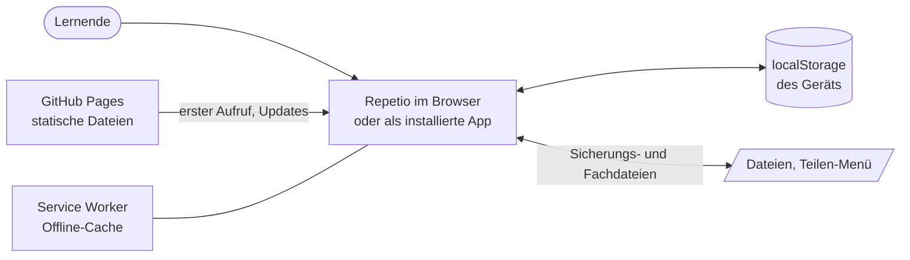
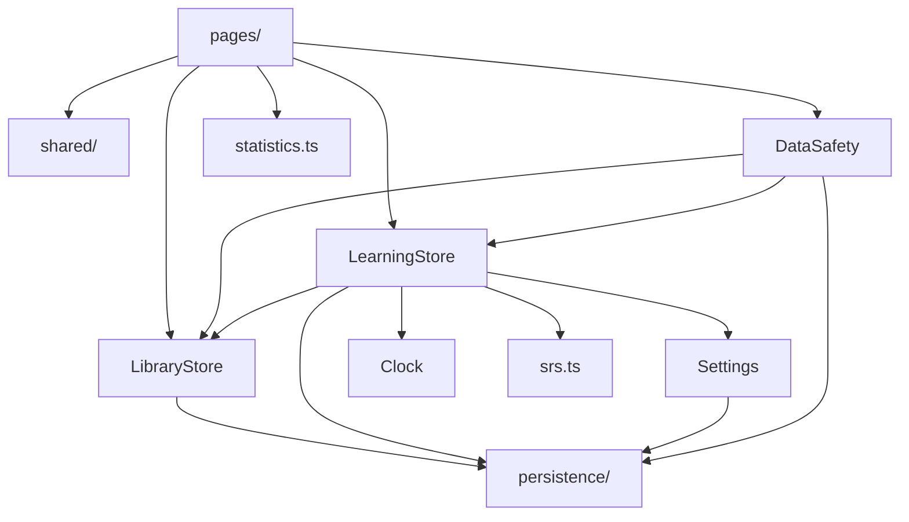

# Architektur

Dieses Dokument beschreibt, **wie** Repetio aufgebaut ist und warum. Die Anforderungen stehen in der [Spezifikation](spezifikation.md).

## 1. Kontext

Repetio ist eine reine Frontend-Anwendung. Es gibt keinen Server und kein Benutzerkonto: Die App wird als statische Dateien ausgeliefert und speichert alle Daten im Browser des Geräts.



## 2. Bausteine

```
src/app/
├── core/                       Logik ohne Oberfläche
│   ├── models.ts               Datenmodell und Prüfungen für Daten von außen
│   ├── settings.ts             Persönliche Einstellungen
│   ├── clock.ts                Uhrzeit als Signal (Fälligkeiten bleiben aktuell)
│   ├── dates.ts                Datumshilfen (Mitternacht, Tage addieren, Tagesschlüssel)
│   ├── data-safety.ts          Sicherungen, Erinnerung, Fach teilen, dauerhafter Speicher
│   ├── id.ts, shuffle.ts       Kleine Hilfsfunktionen
│   ├── library/                Inhalte
│   │   ├── library-store.ts    Fächer, Kapitel, Lerneinheiten anlegen, ändern, löschen, abfragen
│   │   ├── library-copy.ts     Kopie mit neuen ids (Fach aus Datei hinzufügen)
│   │   ├── text-import.ts      Massenimport aus Text
│   │   └── sample/             Beispielfach, wird bei Bedarf nachgeladen
│   ├── learning/               Lernen
│   │   ├── srs.ts              Lernalgorithmus als reine Funktionen
│   │   ├── activity.ts         Lernprotokoll je Tag
│   │   ├── statistics.ts       Kennzahlen der Statistik als reine Funktionen
│   │   └── learning-store.ts   Lernstand, Fälligkeit, Tageslimits, Runde, Zurücknehmen
│   └── persistence/            Speichern
│       ├── persistent-signal.ts  Signal mit automatischer Speicherung
│       ├── storage-keys.ts     Alle Speicherschlüssel
│       ├── migrations.ts       Speicher vorbereiten: alte Daten übernehmen, Beispielfach anlegen
│       ├── backup.ts           Sicherungs- und Fachdateien erstellen und prüfen
│       └── share-file.ts       Datei teilen oder herunterladen
├── pages/                      Eine Komponente je Route; Teile, die nur eine Seite braucht, liegen darunter
│   ├── home/                   Startseite mit backup-reminder/ und streak-card/
│   ├── subject/, chapter/, item-editor/, settings/, search/, text-import/
│   ├── statistics/             Statistik mit maturity-overview/ (Lernstand je Fach)
│   └── session/                Lernrunde mit flashcard-view/ und choice-view/
├── shared/                     Wiederverwendbare Bausteine ohne Services (nur inputs und outputs)
│   ├── page-header/            Kopfzeile einer Unterseite mit Zurück-Link
│   ├── study-card/             Kennzahlen eines Lernumfangs und Start-Button
│   ├── key-figures/            Raster aus Kennzahlen (große Zahl, Beschriftung)
│   ├── progress-row/           Listenzeile für Fach oder Kapitel mit Fortschritt
│   ├── progress-bar/           Schmaler Fortschrittsbalken
│   ├── item-row/               Listenzeile für eine Einheit mit Statusmarkierung
│   ├── bar-chart/              Säulendiagramm ohne Bibliothek
│   ├── segmented-control/      Umschalter, z. B. „14 Tage | 30 Tage“
│   ├── name-form/              Einzeiliges Formular für Namen
│   ├── file-button/            Button zum Auswählen einer Datei
│   ├── validators.ts           Formular-Validierung
│   └── leave-page.ts           Seite nach getaner Arbeit verlassen
├── app.routes.ts               Alle Adressen und welche Seite dazugehört
├── app.links.ts                Link-Ziele zu diesen Adressen, an einer Stelle
└── app.config.ts, app.ts       Start der App und App-Hülle (Hinweise, Design, Badge)
e2e/                            End-to-End-Tests mit Playwright
```

Abhängigkeiten zeigen nur in eine Richtung: Seiten nutzen Bausteine und Services, Services nutzen die Speicherschicht, Lernalgorithmus und Statistik nutzen nichts außer Datumshilfen. Bausteine in `shared/` kennen keine Services – sie bekommen alles über `input()` und melden Aktionen über `output()`. Dadurch lassen sie sich überall einsetzen und einzeln testen.



## 3. Abläufe

**Start der App.** Vor dem ersten Rendern bereitet `prepareStorage` den Speicher vor (siehe `provideAppInitializer` in [`app.config.ts`](../src/app/app.config.ts)): Daten älterer Versionen werden übernommen, und beim allerersten Start wird das Beispielfach angelegt. Es wird dafür per `import()` nachgeladen und liegt deshalb nicht im Startpaket. Danach laden die Services ihre Daten beim ersten Zugriff aus dem localStorage und prüfen deren Form.

**Lernrunde.** Die Startseite, Fachseite oder Kapitelseite verlinkt auf `/lernen?fach=…&kapitel=…`. Die Seite liest den Umfang einmal aus der Adresse und lässt sich vom `LearningStore` eine Warteschlange zusammenstellen (G5). Je nach Art der Einheit zeigt sie `FlashcardView` oder `ChoiceView`. Diese melden nur eine Bewertung zurück; die Seite speichert sie samt Lernzeit über den `LearningStore`. Der berechnet mit `srs.ts` den neuen Lernstand, zählt die Antwort im Lernprotokoll und liefert eine `undo`-Funktion zurück. Für „Rückgängig“ merkt sich die Seite diese Funktion zusammen mit dem Zustand ihrer Warteschlange.

**Zeitabhängige Werte.** Fälligkeiten und Tageslimits hängen von der Uhrzeit ab, ein `computed` reagiert aber nur auf Signals. Deshalb lesen alle Berechnungen die Zeit über `Clock.now()`. Das liest ein Signal, das jede Minute und beim Zurückkehren in die App weiterzählt.

**Statistik.** Das Lernprotokoll speichert je Tag nur Summen (Antworten, richtig, neu gelernt, Lernzeit). Die Statistikseite berechnet daraus und aus dem Lernstand mit den reinen Funktionen in `statistics.ts` Lernserie, Verlauf, Prognose und Lernstand je Fach. Die Diagramme zeichnet der Baustein `BarChart` mit HTML und CSS.

**Speichern.** Jede Änderung an einem `persistentSignal` löst einen `effect` aus, der den Wert als JSON in den localStorage schreibt. Andere Tabs erhalten ein `storage`-Ereignis und übernehmen den neuen Wert. Als installierte App bittet Repetio den Browser zusätzlich, die Daten nicht bei Speichermangel zu löschen (`navigator.storage.persist()`).

**Veröffentlichung.** Bei jedem Push auf `main` prüft der Workflow [`deploy.yml`](../.github/workflows/deploy.yml) Formatierung, Lint, Unit- und End-to-End-Tests, baut die App mit dem Repository-Namen als Basis-Pfad und veröffentlicht sie auf GitHub Pages. Eine Kopie der `index.html` als `404.html` sorgt dafür, dass direkt aufgerufene Unterseiten funktionieren. Der Service Worker lädt neue Versionen im Hintergrund, auch bei jeder Rückkehr in eine geöffnete App; die App blendet dann einen Hinweis zum Neuladen ein.

## 4. Entscheidungen

| Entscheidung                                               | Begründung                                                                                                          | Verworfene Alternative                                                                                                  |
| ---------------------------------------------------------- | ------------------------------------------------------------------------------------------------------------------- | ----------------------------------------------------------------------------------------------------------------------- |
| Kein Backend, Daten im localStorage                        | Keine Kosten, kein Betrieb, offline nutzbar, kein Datenschutzaufwand für Konten                                     | Server mit Synchronisation: deutlich mehr Aufwand; Übertragung zwischen Geräten erfolgt stattdessen per Sicherungsdatei |
| Progressive Web App                                        | Ein Code für iOS, Android und Desktop, Installation ohne App-Store                                                  | Native Apps je Plattform                                                                                                |
| Normalisiertes Datenmodell (Listen mit Verweisen über ids) | Einzelne Objekte lassen sich ändern und löschen, ohne verschachtelte Strukturen neu aufzubauen                      | Fächer mit eingebetteten Kapiteln und Karten                                                                            |
| Inhalte und Lernstand in getrennten Services               | Jeder Service bleibt klein und einzeln testbar; Bearbeiten einer Karte lässt den Lernstand unberührt                | Ein gemeinsamer Service                                                                                                 |
| Lernalgorithmus und Statistik als reine Funktionen         | Ohne Angular testbar und wiederverwendbar                                                                           | Methoden im Service                                                                                                     |
| Vereinfachtes SM-2                                         | Bewährt, leicht nachvollziehbar und mit wenigen Zahlen pro Karte                                                    | FSRS: genauer, aber deutlich komplexer                                                                                  |
| Zwei Bewertungsstufen (richtig/falsch)                     | Schnelle, ehrliche Selbsteinschätzung                                                                               | Vier Stufen wie bei Anki (der Algorithmus unterstützt sie weiterhin)                                                    |
| Signals statt RxJS für Zustand                             | Weniger Code, kein manuelles Abmelden, passt zu Angular ohne zone.js                                                | Observables und Subjects                                                                                                |
| `persistentSignal` als einziger Speicherweg                | Speichern, Prüfen und Tab-Abgleich an einer Stelle                                                                  | Speicheraufrufe in jeder Methode                                                                                        |
| Lernprotokoll als Tagessummen                              | Speicherbedarf wächst nur mit der Zahl der Lerntage (rund 60 Byte pro Tag), nicht mit jeder Antwort                 | Jede Antwort einzeln speichern: genauer, füllt aber den begrenzten localStorage                                         |
| Rückgängig über die vorigen Signal-Werte                   | Signals halten unveränderliche Werte; die alten Werte aufzuheben genügt, nichts muss zurückgerechnet werden         | Gegenbuchungen je Zähler                                                                                                |
| Uhr als Signal (`Clock`)                                   | Zahlen bleiben aktuell, wenn die App über Nacht offen ist; in Tests mit künstlicher Zeit steuerbar                  | `Date.now()` direkt: ein `computed` würde nie neu rechnen                                                               |
| Diagramme mit HTML/CSS statt Bibliothek                    | Wenige Kilobyte statt einer großen Abhängigkeit; Farben und Barrierefreiheit vollständig in eigener Hand            | Chart.js, ECharts o. Ä.                                                                                                 |
| Beispielfach per `import()` nachladen                      | Wird nur beim ersten Start gebraucht; das Startpaket bleibt unabhängig vom Umfang der Beispieldaten                 | Fest im Startpaket                                                                                                      |
| Namensformular ohne Reactive Forms                         | Steht auf der Startseite; für ein Feld genügt ein Signal, das Formular-Modul lädt erst mit dem Editor               | Reactive Forms überall                                                                                                  |
| Farben mit `light-dark()`                                  | Ein Wert je Farbe für beide Designs; das Design lässt sich über `color-scheme` umschalten, ohne doppelte Farbblöcke | Zwei Blöcke für Media-Query und manuell gewähltes Design                                                                |
| End-to-End-Tests mit dem installierten Chrome              | Kein zusätzlicher Browser-Download, lokal und auf dem CI-Server gleich                                              | Von Playwright mitgelieferte Browser                                                                                    |
| Seiten nach getaner Arbeit per „Zurück“ verlassen          | Die Zurück-Taste unter Android führt nicht in erledigte Formulare oder Runden zurück                                | Neue Navigation zur Zielseite                                                                                           |

## 5. Erweitern: So geht's

**Neue Seite.** Ordner unter `pages/` mit `<name>-page.ts`, `.html` und `.css` anlegen. In [`app.routes.ts`](../src/app/app.routes.ts) eine Route mit `loadComponent` eintragen (wird erst beim ersten Aufruf geladen) und für Links eine Funktion in [`app.links.ts`](../src/app/app.links.ts) ergänzen. Seitenkopf über `<app-page-header>`, Daten über `inject(LibraryStore)` bzw. `inject(LearningStore)`.

**Neuer Baustein.** Wird etwas auf mehreren Seiten gebraucht, kommt es nach `shared/<name>/` – mit `input()` für Daten und `output()` für Aktionen, ohne `inject()` von Services. Braucht nur eine Seite einen Teil, liegt er als Unterordner bei dieser Seite (z. B. `pages/home/streak-card/`).

**Neue Einstellung.** Feld in `SettingsData` und `DEFAULT_SETTINGS` ([`settings.ts`](../src/app/core/settings.ts)) ergänzen und auf der Einstellungsseite anzeigen. Ältere gespeicherte Einstellungen bekommen den Standardwert automatisch.

**Neue gespeicherte Daten.** Schlüssel in [`storage-keys.ts`](../src/app/core/persistence/storage-keys.ts) eintragen und im Service mit `persistentSignal(key, standardwert, prüfung)` anlegen. Speichern, Prüfen beim Laden und Tab-Abgleich passieren dann von selbst. Gehören die Daten zur Sicherung, auch [`backup.ts`](../src/app/core/persistence/backup.ts) erweitern und `version` erhöhen.

**Geändertes Speicherformat.** Einen Schritt in [`migrations.ts`](../src/app/core/persistence/migrations.ts) ergänzen, der alte Daten beim Start einmalig umwandelt, und mit einem Test in `migrations.spec.ts` absichern.

**Anderes Beispielfach.** Inhalte in [`sample/`](../src/app/core/library/sample) austauschen. Die ids der Einträge sollten stabil bleiben, weil an ihnen der Lernfortschritt hängt.

**Prüfen.** `npm run lint`, `npm run test:ci` und `npm run e2e` laufen auch in der CI; reine Funktionen (z. B. in `statistics.ts`) lassen sich ohne Angular testen.

## 6. Querschnittsthemen

- **Zustand:** Services halten Daten in Signals; Seiten leiten Anzeigewerte mit `computed` ab. Routen- und Query-Parameter kommen über `withComponentInputBinding` als `input()` in die Seiten. Nachschlagetabellen (id → Objekt, Einheiten je Kapitel und Fach) sind ebenfalls `computed` und werden nur bei Änderungen neu aufgebaut.
- **Validierung:** Formulare nutzen Reactive Forms mit dem Validator `notBlank`. Daten aus dem localStorage und aus Dateien werden mit den Prüfungen aus `models.ts`, `activity.ts` und `backup.ts` kontrolliert, bevor die App sich auf sie verlässt.
- **Versionierung der Daten:** Änderungen am Speicherformat bekommen einen Schritt in `migrations.ts`, der alte Daten beim Start einmalig überträgt. Das Sicherungsformat trägt eine Versionsnummer; ältere Versionen bleiben lesbar.
- **Gestaltung:** Farben, Abstände und Radien sind CSS-Variablen in [`styles.css`](../src/styles.css), mit `light-dark()` für helles und dunkles Design. Gemeinsame Klassen wie `.card`, `.btn`, `.list`, `.hint`, `.pill` und `.clamp-2` sind global, Komponenten-Styles enthalten nur Spezifisches. Wer weniger Bewegung wünscht (`prefers-reduced-motion`), bekommt keine Animationen.
- **Barrierefreiheit:** Touch-Ziele von mindestens 44 px, Tastaturkürzel (auch `Z` für Rückgängig), ARIA-Rollen für Fortschritt (`progressbar`), Rückmeldungen (`status`, `alert`) und Diagramme (Liste mit Beschreibung je Säule, Lernstand als `img` mit Text). ESLint prüft die Templates auf gängige Barrierefreiheitsfehler.
- **Codequalität:** TypeScript im strikten Modus, ESLint, einheitliche Formatierung mit Prettier, Kommentare zu Zweck und zu Angular-spezifischen Konstrukten.
