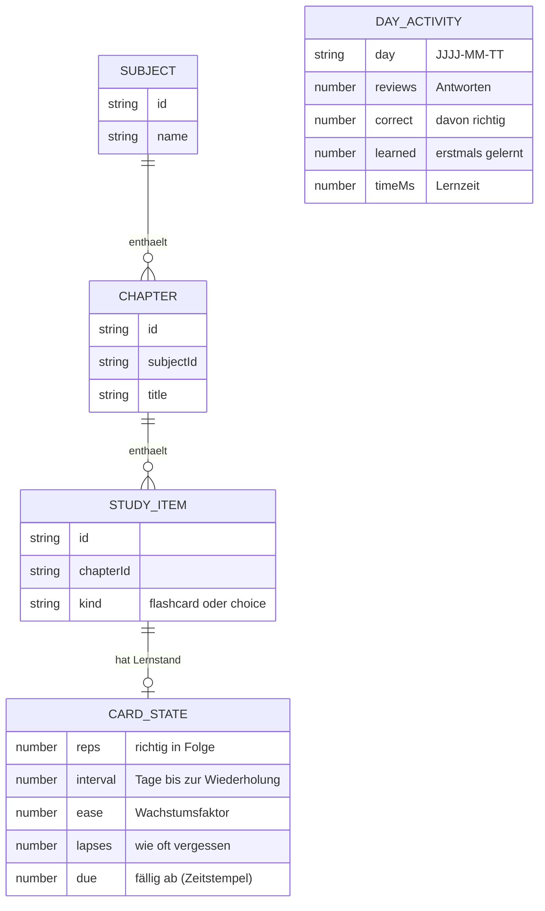

# Spezifikation

Dieses Dokument beschreibt, **was** Repetio leisten soll: Ziel, fachliche Anforderungen, Geschäftsregeln, Datenmodell, Schnittstellen und messbare Qualitätsanforderungen. **Wie** das umgesetzt ist, beschreibt die [Architektur](architektur.md).

## 1. Ziel

Repetio unterstützt das langfristige Behalten von Lernstoff. Inhalte werden als Karteikarten und Quizfragen in Fächern und Kapiteln abgelegt; die App plant Wiederholungen so, dass sicher Gewusstes seltener und Unsicheres häufiger abgefragt wird. Die App soll auf Smartphone und PC funktionieren, auch ohne Internetverbindung, und ohne Benutzerkonto oder Server auskommen.

## 2. Funktionale Anforderungen

| Nr. | Anforderung                                                                                                                                                                                                                            |
| --- | -------------------------------------------------------------------------------------------------------------------------------------------------------------------------------------------------------------------------------------- |
| F1  | Fächer anlegen, umbenennen und löschen.                                                                                                                                                                                                |
| F2  | Kapitel innerhalb eines Fachs anlegen, umbenennen und löschen.                                                                                                                                                                         |
| F3  | Karteikarten (Frage, Antwort) und Quizfragen (Frage, eine richtige Antwort, ein bis drei falsche Antworten, optionale Begründung) anlegen, bearbeiten und löschen; beim Anlegen auch mehrere hintereinander („Speichern & nächste“).   |
| F4  | Eine Lernrunde über alle Fächer, ein Fach oder ein Kapitel starten.                                                                                                                                                                    |
| F5  | Karteikarten abfragen: Antwort optional eintippen, Musterlösung aufdecken, selbst als richtig oder falsch bewerten.                                                                                                                    |
| F6  | Quizfragen abfragen: Antworten in zufälliger Reihenfolge anzeigen, Auswahl automatisch auswerten, Begründung anzeigen.                                                                                                                 |
| F7  | Für jedes Fach und jedes Kapitel anzeigen, wie viele Einheiten fällig, neu und gelernt sind.                                                                                                                                           |
| F8  | Je Einheit anzeigen, wann sie wieder fällig ist („neu“, „fällig“, „morgen“, „in 5 T“).                                                                                                                                                 |
| F9  | Tageslimits für neue Karteikarten und Quizfragen einstellen; ist das Limit erreicht, auf Wunsch trotzdem weitere neue Einheiten lernen.                                                                                                |
| F10 | Alle Inhalte samt Lernstand und Statistik als Datei sichern und eine Sicherung wieder einlesen.                                                                                                                                        |
| F11 | Ein Beispielfach mitliefern und nach dem Löschen wiederherstellen können.                                                                                                                                                              |
| F12 | Lernstand und Statistik zurücksetzen, ohne Inhalte zu löschen.                                                                                                                                                                         |
| F13 | Statistik anzeigen: Lernserie, Antworten heute, Trefferquote und Lernzeit eines Zeitraums, Antworten pro Tag (14 oder 30 Tage), Prognose der fälligen Wiederholungen (14 Tage), Lernstand je Fach, am häufigsten vergessene Einheiten. |
| F14 | Viele Karteikarten oder Quizfragen auf einmal aus Text anlegen (Massenimport), mit Vorschau und Hinweis auf nicht erkannte Zeilen.                                                                                                     |
| F15 | Ein Fach ohne Lernstand als Datei teilen und Fächer aus einer solchen Datei (oder einer Sicherung) zu den vorhandenen hinzufügen.                                                                                                      |
| F16 | Bewertungen in einer Lernrunde schrittweise zurücknehmen.                                                                                                                                                                              |
| F17 | Alle Karteikarten und Quizfragen durchsuchen.                                                                                                                                                                                          |
| F18 | An eine Sicherung erinnern, den Zeitpunkt der letzten Sicherung und den belegten Speicher anzeigen und den Browser um dauerhafte Speicherung bitten.                                                                                   |
| F19 | Das Design wählen: wie System, hell oder dunkel.                                                                                                                                                                                       |

## 3. Geschäftsregeln

| Nr. | Regel                                                                                                                                                                                                                                                                                                                         |
| --- | ----------------------------------------------------------------------------------------------------------------------------------------------------------------------------------------------------------------------------------------------------------------------------------------------------------------------------- |
| G1  | Jede Lerneinheit gehört zu genau einem Kapitel, jedes Kapitel zu genau einem Fach.                                                                                                                                                                                                                                            |
| G2  | Wird ein Fach gelöscht, werden seine Kapitel und Lerneinheiten mitgelöscht; ebenso die Lerneinheiten eines gelöschten Kapitels.                                                                                                                                                                                               |
| G3  | Namen und Pflichtfelder dürfen nicht leer sein und nicht nur aus Leerzeichen bestehen. Pflicht sind: bei Karteikarten Frage und Antwort, bei Quizfragen Frage, richtige Antwort und mindestens eine falsche Antwort.                                                                                                          |
| G4  | Pro Fach und Tag kommen höchstens so viele **neue** Einheiten in Lernrunden, wie die Einstellungen erlauben (Standard: 10 Karteikarten, 5 Quizfragen; erlaubt: 0–100). Fällige Wiederholungen sind nicht begrenzt. „Trotzdem weitere lernen“ erlaubt je Fach und Art 10 zusätzliche.                                          |
| G5  | Eine Lernrunde enthält zuerst die fälligen Einheiten (die am längsten fälligen zuerst), danach neue Einheiten, Karteikarten und Quizfragen im Wechsel.                                                                                                                                                                        |
| G6  | Planung nach Bewertung (vereinfachtes SM-2): „richtig“ verlängert das Intervall (1 → 3 Tage, danach Intervall × Wachstumsfaktor, Start 2,5); „falsch“ setzt die Einheit zurück; sie kommt am Ende derselben Runde erneut (und ist spätestens nach 1 Minute wieder fällig), der Wachstumsfaktor sinkt um 0,2 (mindestens 1,3). |
| G7  | Eine Einheit mit einem Intervall in Tagen ist ab Mitternacht des Zieltages fällig. Fälligkeiten und Tageslimits folgen der Uhrzeit auch dann, wenn die App über Mitternacht geöffnet bleibt.                                                                                                                                  |
| G8  | Wird eine Einheit bearbeitet, bleibt ihr Lernstand erhalten.                                                                                                                                                                                                                                                                  |
| G9  | Das Einlesen einer Sicherung ersetzt nach Bestätigung alle Inhalte, den Lernstand und die Statistik vollständig. Eine ungültige Datei verändert nichts.                                                                                                                                                                       |
| G10 | Die Statistik zählt je Tag Antworten, davon richtige, erstmals gelernte Einheiten und Lernzeit. Pro Antwort zählen höchstens 2 Minuten Lernzeit. Die Lernserie zählt aufeinanderfolgende Tage mit mindestens einer Antwort; ein heute noch ungenutzter Tag unterbricht sie nicht.                                             |
| G11 | Lernstand je Einheit: **neu** (nie gelernt), **in Arbeit** (zuletzt falsch, Intervall 0), **gelernt** (Intervall unter 21 Tagen), **gefestigt** (21 Tage und mehr).                                                                                                                                                           |
| G12 | Das Zurücknehmen einer Bewertung stellt Lernstand, Tageszähler und Statistik auf den Stand davor zurück.                                                                                                                                                                                                                      |
| G13 | Fächer aus einer Datei werden als Kopie mit neuen ids und ohne Lernstand hinzugefügt; vorhandene Fächer bleiben unverändert.                                                                                                                                                                                                  |
| G14 | An eine Sicherung wird erinnert, wenn die letzte älter als 7 Tage ist – oder, falls es noch keine gibt, ab dem zweiten Tag mit Antworten.                                                                                                                                                                                     |

## 4. Datenmodell



Eine Lerneinheit (`STUDY_ITEM`) ist entweder eine Karteikarte (`front`, `back`) oder eine Quizfrage (`question`, `correct`, `wrong[]`, `explanation`). Neue Einheiten haben noch keinen Lernstand. `DAY_ACTIVITY` ist das Lernprotokoll für die Statistik: eine Summe je Tag, unabhängig von einzelnen Einheiten. Die Typen stehen in [`models.ts`](../src/app/core/models.ts) und [`activity.ts`](../src/app/core/learning/activity.ts).

## 5. Schnittstellen

### Benutzeroberfläche und Adressen

| Adresse                                                                 | Seite                                      |
| ----------------------------------------------------------------------- | ------------------------------------------ |
| `/`                                                                     | Tagesrunde, Lernserie und Liste der Fächer |
| `/fach/:subjectId`                                                      | Kapitel eines Fachs                        |
| `/fach/:subjectId/kapitel/:chapterId`                                   | Karteikarten und Quizfragen eines Kapitels |
| `/fach/:subjectId/kapitel/:chapterId/neu/karteikarte` bzw. `…/neu/quiz` | Neue Einheit                               |
| `/fach/:subjectId/kapitel/:chapterId/eintrag/:itemId`                   | Einheit bearbeiten                         |
| `/fach/:subjectId/kapitel/:chapterId/import?art=karteikarte\|quiz`      | Massenimport                               |
| `/lernen?fach=…&kapitel=…`                                              | Lernrunde (beide Parameter optional)       |
| `/statistik`                                                            | Statistik                                  |
| `/suche`                                                                | Suche                                      |
| `/einstellungen`                                                        | Einstellungen, Sicherung                   |

Die installierte App bietet die Lernrunde, die Statistik und die Suche zusätzlich als Kurzbefehle am App-Symbol an.

### Sicherungsdatei

UTF-8-kodiertes JSON, Dateiname `repetio-JJJJ-MM-TT.json`:

```json
{
  "format": "repetio-backup",
  "version": 2,
  "exportedAt": "2026-10-19T19:20:00.000Z",
  "library": {
    "subjects": [{ "id": "beispiel", "name": "Beispielfach: Besser lernen" }],
    "chapters": [{ "id": "beispiel-1", "subjectId": "beispiel", "title": "Repetio kennenlernen" }],
    "items": [
      { "kind": "flashcard", "id": "b1-01", "chapterId": "beispiel-1", "front": "…", "back": "…" },
      {
        "kind": "choice",
        "id": "q1-01",
        "chapterId": "beispiel-1",
        "question": "…",
        "correct": "…",
        "wrong": ["…", "…"],
        "explanation": "…"
      }
    ]
  },
  "progress": {
    "b1-01": { "reps": 2, "interval": 3, "ease": 2.5, "lapses": 0, "due": 1792800000000 }
  },
  "activity": {
    "2026-10-19": { "reviews": 24, "correct": 20, "learned": 8, "timeMs": 540000 }
  }
}
```

Beim Einlesen werden `format`, `version` und der Aufbau von `library`, `progress` und `activity` geprüft. `progress` enthält nur Einträge für Einheiten, die in `library` vorkommen. Dateien der Version 1 (ohne `activity`) werden weiterhin gelesen; die Statistik ist dann leer. Eine künftige Änderung des Formats erhöht `version`.

### Fachdatei zum Teilen

Gleicher Aufbau wie `library` oben, eingebettet in `{ "format": "repetio-subjects", "version": 1, "exportedAt": "…", "library": { … } }`, ohne Lernstand. Dateiname `repetio-<fachname>.json`. „Fach aus Datei“ akzeptiert auch eine vollständige Sicherung und übernimmt dann nur deren Inhalte (G13).

### Textformat des Massenimports

Eine Zeile pro Einheit; Spalten getrennt durch Tabulator (falls die Zeile einen enthält) oder Semikolon. Leere Zeilen und Zeilen mit `#` am Anfang werden übersprungen. In Anführungszeichen gesetzte Spalten (CSV) und `<br>` (Anki) werden verstanden.

| Art         | Spalten                                                                                                                        |
| ----------- | ------------------------------------------------------------------------------------------------------------------------------ |
| Karteikarte | `Frage ; Antwort` – weitere Semikolons gehören zur Antwort                                                                     |
| Quizfrage   | `Frage ; richtige Antwort ; falsche Antwort ; …` mit 1–3 falschen Antworten; bei genau 6 Spalten ist die letzte die Begründung |

## 6. Qualitätsanforderungen

Jede Anforderung ist so formuliert, dass ihre Erfüllung geprüft werden kann. „Automatisch“ bedeutet: Die Prüfung läuft bei jedem Push in der CI.

| Merkmal              | Anforderung                                                                                                                                                                                                                                | Prüfung                                                                                                                                                                                                                                                                                    |
| -------------------- | ------------------------------------------------------------------------------------------------------------------------------------------------------------------------------------------------------------------------------------------ | ------------------------------------------------------------------------------------------------------------------------------------------------------------------------------------------------------------------------------------------------------------------------------------------ |
| Korrektheit          | Die Planung erfüllt G4–G7, z. B. ergeben fünfmal „richtig“ in Folge die Intervalle 1, 3, 8, 20 und 50 Tage. Statistik, Import und Zurücknehmen erfüllen G10–G13.                                                                           | automatisch: [`srs.spec.ts`](../src/app/core/learning/srs.spec.ts), [`learning-store.spec.ts`](../src/app/core/learning/learning-store.spec.ts), [`statistics.spec.ts`](../src/app/core/learning/statistics.spec.ts), [`text-import.spec.ts`](../src/app/core/library/text-import.spec.ts) |
| Zuverlässigkeit      | Jede Änderung wird unmittelbar gespeichert, ohne eigenen Speichern-Schritt. Sind mehrere Tabs geöffnet, übernimmt jeder die Änderungen der anderen, statt sie zu überschreiben. Zahlen bleiben aktuell, wenn die App über Nacht offen ist. | automatisch: [`persistent-signal.spec.ts`](../src/app/core/persistence/persistent-signal.spec.ts), [`learning-store.spec.ts`](../src/app/core/learning/learning-store.spec.ts)                                                                                                             |
| Zuverlässigkeit      | Nach dem ersten Aufruf startet die App auch ohne Netzverbindung und alle Seiten sind erreichbar. Eine geöffnete App prüft bei jeder Rückkehr in den Vordergrund auf Updates.                                                               | manuell: Produktions-Build offline neu laden, Unterseite direkt aufrufen                                                                                                                                                                                                                   |
| Robustheit           | Ungültige Eingaben werden mit Hinweis abgelehnt (G3). Eine ungültige Sicherungsdatei wird abgelehnt, ohne Daten zu verändern (G9). Nicht erkannte Zeilen im Massenimport werden mit Grund gemeldet.                                        | automatisch: [`name-form.spec.ts`](../src/app/shared/name-form/name-form.spec.ts), [`backup.spec.ts`](../src/app/core/persistence/backup.spec.ts), [`text-import.spec.ts`](../src/app/core/library/text-import.spec.ts)                                                                    |
| Robustheit           | Beschädigte gespeicherte Daten führen nicht zum Absturz; der beschädigte Inhalt bleibt unter `<schlüssel>.defekt` erhalten. Ein voller Speicher wird gemeldet. An Sicherungen wird erinnert (G14).                                         | automatisch: [`persistent-signal.spec.ts`](../src/app/core/persistence/persistent-signal.spec.ts), [`data-safety.spec.ts`](../src/app/core/data-safety.spec.ts)                                                                                                                            |
| Usability            | Alle Bedienelemente sind mindestens 44 × 44 px groß. Eine Lernrunde ist vollständig per Tastatur bedienbar. Fortschritt, Diagramme und Rückmeldungen sind für Screenreader ausgezeichnet. Die Hauptabläufe funktionieren im Browser.       | automatisch: Barrierefreiheitsregeln von ESLint für Templates, End-to-End-Tests in [`e2e/`](../e2e); manuell: Lighthouse-Barrierefreiheit 100                                                                                                                                              |
| Performanz           | Der erste Download (Initial-Bundle) ist komprimiert kleiner als 100 kB (derzeit 83 kB). Unterseiten und Beispieldaten werden erst bei Bedarf geladen.                                                                                      | automatisch: Größenbudget in [`angular.json`](../angular.json) – der Build bricht ab 370 kB unkomprimiert ab, was etwa 100 kB komprimiert entspricht                                                                                                                                       |
| Wartbarkeit          | Logik ohne Oberfläche liegt in `core/`, Seiten in `pages/`, wiederverwendbare Bausteine in `shared/`. Formatierung, Lint, Unit- und End-to-End-Tests und Build werden bei jedem Push geprüft.                                              | automatisch: [`deploy.yml`](../.github/workflows/deploy.yml)                                                                                                                                                                                                                               |
| Wiederverwendbarkeit | Lernalgorithmus und Statistik hängen nicht von Angular ab. Die UI-Bausteine in `shared/` greifen auf keinen Service zu.                                                                                                                    | Code-Review                                                                                                                                                                                                                                                                                |
| Portierbarkeit       | Die App läuft in aktuellen Browsern unter Windows, macOS, Android und iOS, ist als App installierbar und braucht nur statisches Hosting. Das Layout funktioniert ab 320 px Breite ohne waagrechtes Scrollen.                               | manuell: Prüfung in Handy- und Desktop-Größe                                                                                                                                                                                                                                               |
| Interoperabilität    | Sicherungsdatei, Fachdatei und Importformat sind dokumentiert (Abschnitt 5) und versioniert. Der Massenimport liest Tabellen aus Excel und Textexporte aus Anki.                                                                           | Dokumentation, automatisch: [`text-import.spec.ts`](../src/app/core/library/text-import.spec.ts)                                                                                                                                                                                           |
